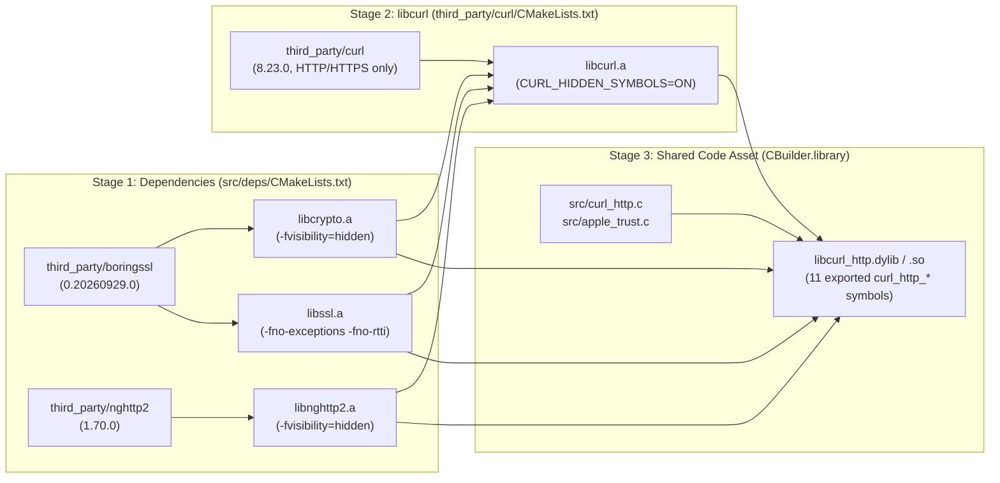
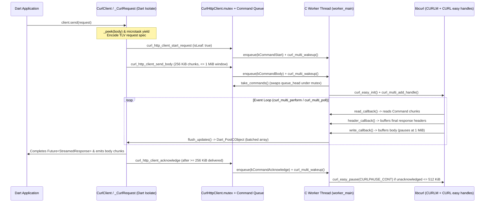

# `package:curl_http` Architecture & Design Document

[`package:curl_http`](..) is a cross-platform `package:http` `Client` implementation backed by **libcurl 8.23.0**, **nghttp2 1.70.0**, and **BoringSSL**. It compiles its entire native networking and cryptographic stack from vendored source code via a Dart build hook ([`hook/build.dart`](../hook/build.dart)) and drives transfers asynchronously on a dedicated native worker thread per [`CurlClient`](../lib/src/curl_client.dart).

---

## 1. Design Goals & Requirements

1. **Full `package:http` Conformance**: Pass all [`http_client_conformance_tests`](../test/client_conformance_test.dart) across HTTP/1.1 and HTTP/2, including streaming request/response bodies, `Abortable` requests, redirects (`301`/`302`/`303`/`307`/`308`), custom methods, header case/folding edge cases, and connection pooling.
2. **Hermetic, Zero-Dependency Deployment**: Require no system-installed `libcurl`, OpenSSL, or nghttp2 at runtime, and guarantee identical protocol support (ALPN, HTTP/2 multiplexing, modern TLS 1.3 cipher suites) across macOS, Linux, Android, and iOS.
3. **Zero Symbol Collisions with Embedders**: Coexist safely in processes that already link different versions of BoringSSL, OpenSSL, or libcurl (most notably the Dart standalone VM and the Flutter engine).
4. **Non-Blocking Dart Event Loop**: Never block the calling Dart isolate on DNS resolution, socket I/O, TLS handshakes, or lock contention.
5. **Bounded Memory under Backpressure**: Enforce strict memory ceilings (1 MiB per transfer direction) when uploading to slow servers or downloading into paused/slow Dart `StreamSubscription`s.
6. **Leak-Free Lifecycle Across GC & Isolate Exits**: Reclaim all native handles, threads, and buffers deterministically on `CurlClient.close()`, when an unclosed `CurlClient` is garbage-collected, or when a Dart isolate exits abruptly mid-transfer.

---

## 2. System Architecture

### 2.1 Component Map

| Layer | File(s) | Responsibility |
| :--- | :--- | :--- |
| **Public Dart API & Client State** | [`lib/curl_http.dart`](../lib/curl_http.dart), [`lib/src/curl_client.dart`](../lib/src/curl_client.dart) | `CurlClient`, `_ClientState`, `_CurlRequest`, `_BodySender`, gzip/deflate decoding, header parsing, and stream backpressure. |
| **FFI & TLV Wire Protocol** | [`lib/src/native.dart`](../lib/src/native.dart) | `@Native(..., isLeaf: true)` FFI bindings, `TlvBuilder` encoder, and `clientFinalizer`. |
| **C Shim & Worker Loop** | [`src/curl_http.h`](../src/curl_http.h), [`src/curl_http.c`](../src/curl_http.c), [`src/dart_cobject.h`](../src/dart_cobject.h) | Non-blocking command queue, worker thread driving `curl_multi`, libcurl callbacks, and batched `Dart_PostCObject` updates. |
| **Apple Trust Bridge** | [`src/apple_trust.h`](../src/apple_trust.h), [`src/apple_trust.c`](../src/apple_trust.c) | macOS/iOS `Security.framework` (`SecTrustEvaluateWithError`) fallback when BoringSSL rejects a custom CA chain (e.g., IP name constraints). |
| **Build & Vendoring Pipeline** | [`hook/build.dart`](../hook/build.dart), [`src/deps/CMakeLists.txt`](../src/deps/CMakeLists.txt), [`tool/vendor_third_party.sh`](../tool/vendor_third_party.sh) | Three-stage incremental CMake + `CBuilder` compilation producing a single stripped dynamic library with hidden internal symbols. |

### 2.2 Three-Stage Native Build Pipeline

[`hook/build.dart`](../hook/build.dart) compiles the vendored sources in `third_party/` into a single code asset (`package:curl_http/curl_http.dart`) in three sequential stages:



### 2.3 Runtime Threading & Data-Flow Architecture

Each [`CurlClient`](../lib/src/curl_client.dart) lazily initializes a `_ClientState` on its first request, creating one `RawReceivePort`, one native `CurlHttpClient` struct, one `CURLM*` multi handle, and one detached native worker thread (`worker_main`):



---

## 3. Core Design Choices & Rationale

### 3.1 Hermetic Static Build & Strict Symbol Isolation

* **Why compile from source instead of linking the OS `libcurl`?**
  * System `libcurl` availability and capabilities vary wildly: Windows and Android do not ship a public C `libcurl` ABI for apps; Linux distributions link against different TLS backends (OpenSSL 1.1, OpenSSL 3.x, GnuTLS) with differing error codes and ALPN support; macOS links `libcurl` against LibreSSL/SecureTransport with version-dependent HTTP/2 quirks.
  * Compiling **BoringSSL (`0.20260929.0`)**, **nghttp2 (`1.70.0`)**, and **libcurl (`8.23.0`)** from source guarantees identical TLS 1.3, ALPN, and HTTP/2 multiplexing behavior everywhere.
* **Why a two-step CMake build followed by `CBuilder.library`?**
  * libcurl's `CMakeLists.txt` executes `try_compile` feature checks against OpenSSL/BoringSSL and nghttp2 during configuration. Building BoringSSL and nghttp2 first in [`src/deps/CMakeLists.txt`](../src/deps/CMakeLists.txt) and installing them into `deps/` allows libcurl's CMake configuration to link against already-built static archives.
  * Both CMake build trees (`deps-build/` and `curl-build/`) are persisted inside the hook's `outputDirectory` alongside a `curl_http_defines.txt` cache key (`_CMake.build`), making subsequent builds incremental when editing [`src/curl_http.c`](../src/curl_http.c).
* **How symbol collisions with the Dart VM / Flutter Engine are prevented:**
  * The Dart VM (`dart:io`) and Flutter engine statically link their own version of BoringSSL. If `libcurl_http` exported global BoringSSL symbols (`SSL_new`, `CRYPTO_malloc`, etc.), dynamic linker interposition on Linux/Android would corrupt memory across BoringSSL versions.
  * [`src/deps/CMakeLists.txt`](../src/deps/CMakeLists.txt) compiles all static libraries with `CMAKE_C_VISIBILITY_PRESET=hidden`, `CMAKE_CXX_VISIBILITY_PRESET=hidden`, and `BORINGSSL_TEMPORARY_NO_CXX_RUNTIME`.
  * [`hook/build.dart`](../hook/build.dart) passes an explicit export list (`-Wl,-exported_symbols_list` on Apple, `-Wl,--version-script` + `-Wl,--exclude-libs,ALL` + `-Wl,-Bsymbolic` on Linux/Android) so that **only** the 11 `curl_http_*` C functions in `_exportedSymbols` are visible in the dynamic symbol table, allowing `-Wl,-dead_strip` / `-Wl,--gc-sections` to strip unused BoringSSL and libcurl code.
* **Aggressive libcurl feature pruning:**
  * `_curlDefines` in [`hook/build.dart`](../hook/build.dart) disables 14 non-HTTP protocols (`FTP`, `IMAP`, `SMB`, `LDAP`, etc.), disables unused HTTP features (`COOKIES`, `DOH`, `MIME`, `HSTS`, `AWS`, `NTLM`, `PROGRESS_METER`), and disables native compression libraries (`CURL_ZLIB=OFF`, `CURL_BROTLI=OFF`, `CURL_ZSTD=OFF`) in favor of Dart's built-in `ZLibDecoder` (`_createDecoder`), avoiding an extra native `zlib` dependency.

### 3.2 Dedicated C Worker Thread + `curl_multi_poll` vs. Direct Dart FFI

* **Why not call `curl_easy_perform` or `curl_multi_perform` directly from Dart FFI?**
  1. `curl_easy_perform` blocks an OS thread per in-flight request and cannot multiplex concurrent HTTP/2 streams over a single TCP/TLS connection (`CURLPIPE_MULTIPLEX` requires `curl_multi`).
  2. Driving `curl_multi_perform` directly from Dart is incompatible with Dart FFI callback semantics: libcurl invokes `CURLOPT_READFUNCTION`, `CURLOPT_WRITEFUNCTION`, `CURLOPT_HEADERFUNCTION`, and `CURLOPT_SEEKFUNCTION` **synchronously** on the thread calling `curl_multi_perform` and requires a synchronous return value (number of bytes transferred, `CURL_READFUNC_PAUSE`, `CURL_WRITEFUNC_PAUSE`, or `CURL_SEEKFUNC_OK`).
  3. Dart's `NativeCallable.listener` is asynchronous (`void`-returning only) and cannot return values to libcurl, while `NativeCallable.isolateLocal` requires the call to occur on the owning Dart isolate thread and still cannot `await` asynchronous Dart `Stream` events inside a synchronous C callback.
* **Why a lock-free-path C command queue + `curl_multi_wakeup`?**
  * All Dart-to-C FFI entrypoints in [`lib/src/native.dart`](../lib/src/native.dart) are marked `@Native(..., isLeaf: true)`. Because `isLeaf: true` calls cannot re-enter the Dart VM, the VM skips thread-state transition bookkeeping, making each FFI call nearly as cheap as a normal C function call.
  * On the C side, `enqueue` in [`src/curl_http.c`](../src/curl_http.c) allocates a `Command`, appends it to `client->queue_tail` under `client->mutex`, and calls `curl_multi_wakeup(client->multi)` **only** on the transition from `!wakeup_pending` to `wakeup_pending`.
  * This `wakeup_pending` coalescing prevents redundant socketpair/pipe writes when Dart enqueues multiple commands in a single turn, while holding `client->mutex` across `curl_multi_wakeup` guarantees the worker thread cannot concurrently destroy `client->multi` during shutdown.
  * On the worker thread, `take_commands` swaps `queue_head` to `NULL` in $O(1)$ time under the mutex and processes the entire batch lock-free.

### 3.3 Wire Protocol: TLV Input & Batched `Dart_PostCObject` Output

* **Why Tag-Length-Value (TLV) encoding for configurations and requests?**
  * Passing complex structs with optional fields, variable-length strings, and repeated headers across FFI via `malloc`/`free` per field requires numerous FFI calls and error-prone pointer management in Dart.
  * `TlvBuilder` in [`lib/src/native.dart`](../lib/src/native.dart) packs an entire client config or request specification into a single contiguous `Uint8List` in Dart memory and passes its pointer directly via `spec.address`, which is safe because `@Native(..., isLeaf: true)` prevents Dart GC from moving typed-data backing stores during the call.
* **Why self-contained [`src/dart_cobject.h`](../src/dart_cobject.h) instead of linking `dart_api_dl.c`?**
  * Instead of bundling the full Dart SDK `include/` tree, `curl_http_initialize` receives `NativeApi.postCObject` and verifies `NativeApi.majorVersion == CURL_HTTP_DART_API_DL_MAJOR_VERSION` (`2`).
* **Why batch updates across requests and use a 64 KiB `kExternalTypedDataThreshold`?**
  * After each `curl_multi_perform` pass, `flush_updates` in [`src/curl_http.c`](../src/curl_http.c) collects all requests on the `client->dirty` list and posts them in a **single** `Dart_PostCObject` array message (`[[id, headers, body, bodyConsumed, done], ...]`), amortizing port wakeup overhead when many multiplexed HTTP/2 streams make progress simultaneously.
  * Inside `write_callback`, response chunks accumulate in `request->body` up to `kMaxBodyChunk` (256 KiB, matching `CURLOPT_BUFFERSIZE` = 256 KiB).
  * In `build_update`, buffers `< 64 KiB` (`kExternalTypedDataThreshold`) are posted as `Dart_CObject_kTypedData` (copied by the VM so the C buffer can be reused immediately without `malloc`/`free` churn), whereas buffers `>= 64 KiB` are posted as `Dart_CObject_kExternalTypedData` with `free_external_buffer`, transferring ownership of the heap buffer to Dart with **zero copy**.

### 3.4 Bidirectional Windowed Flow Control & Redirect Body Rewinding

```mermaid
stateDiagram-v2
    state "Download Flow Control (Receive Window = 1 MiB)" as Download {
        [*] --> Receiving
        Receiving --> Receiving: write_callback()\nunacknowledged += len
        Receiving --> RecvPaused: unacknowledged >= 1 MiB\ncurl_easy_pause(CURLPAUSE_RECV)
        RecvPaused --> Receiving: kCommandAcknowledge\nunacknowledged <= 512 KiB\ncurl_easy_pause(CURLPAUSE_CONT)
    }
    --
    state "Upload Flow Control (Send Window = 1 MiB)" as Upload {
        [*] --> Sending
        Sending --> SendPaused: read_callback() has no chunks\nreturns CURL_READFUNC_PAUSE
        SendPaused --> Sending: kCommandBody / kCommandEndBody\ncurl_easy_pause(CURLPAUSE_CONT)
        Sending --> DartStreamPaused: _outstanding >= 1 MiB\nsubscription.pause()
        DartStreamPaused --> Sending: onConsumed(bodyConsumed)\n_outstanding < 1 MiB -> subscription.resume()
    }
```

* **Download Backpressure (High/Low Watermark Hysteresis):**
  * The C shim tracks `request->unacknowledged` bytes posted to Dart. When `unacknowledged >= receive_window` (1 MiB), it calls `curl_easy_pause(request->easy, pause_bits(request))` with `CURLPAUSE_RECV`.
  * On the Dart side, `_CurlRequest._deliver` only drains `_pendingBody` into `_controller` while `controller.hasListener && !controller.isPaused`, and sends `native.acknowledge` in batches of `_acknowledgeThreshold` (256 KiB = `receiveWindow ~/ 4`).
  * The C worker only unpauses `CURLPAUSE_RECV` once `unacknowledged <= receive_window / 2` (512 KiB), avoiding rapid pause/unpause oscillation.
* **Upload Backpressure & `307`/`308` Rewind High-Water Invariant:**
  * `_BodySender` in [`lib/src/curl_client.dart`](../lib/src/curl_client.dart) slices incoming stream chunks into `_maxSendChunk` (256 KiB) pieces and pauses the Dart `StreamSubscription` whenever `_outstanding >= _sendWindow` (1 MiB).
  * If libcurl follows a `307` or `308` redirect (or retries on a stale connection), it invokes `seek_callback` to rewind the request body to offset 0.
  * To support rewinding without buffering unbounded uploads in RAM, `advance_body_chunk` retains already-read `Command` chunks between `body_first` and `body_read` up to `kMaxRetainedBody` (1 MiB). Once a request body exceeds 1 MiB—or once the final response headers arrive (`finalize_headers`)—`request_release_retained_body` frees the retained chunks and sets `body_rewindable = false`.
  * **High-Water Consumption Accounting**: When a body is rewound (`body_position = 0`), re-reading the first $N$ bytes must **not** report those bytes as newly consumed to Dart's `_BodySender` (which would corrupt `_outstanding` flow control). `read_callback` tracks both `body_position` and `body_high_water`, incrementing `body_consumed` only when `body_position > body_high_water`.

### 3.5 Hybrid TLS Trust Verification (BoringSSL + Apple `SecTrust`)

* **System Trust Store Discovery:**
  * When `trustedCertificates` is `null`, macOS and Windows enable `CURLSSLOPT_NATIVE_CA` so libcurl queries the OS certificate store alongside BoringSSL.
  * On Android and Linux, `config_find_trust_store` in [`src/curl_http.c`](../src/curl_http.c) honors `SSL_CERT_FILE` / `SSL_CERT_DIR` and probes standard distribution CA bundle paths (matching Go's `crypto/x509` root discovery).
* **Why [`src/apple_trust.c`](../src/apple_trust.c) is needed on macOS and iOS:**
  * BoringSSL's X.509 verifier rejects certificate chains whose CA uses certain X.509 extensions, such as name constraints on IP addresses (`unsupported name constraint type`).
  * However, `dart:io` on macOS/iOS accepts such certificates because it delegates verification to Apple's `Security.framework`.
  * When `trustedCertificates` are supplied on Apple platforms, `configure_tls` registers `ssl_ctx_callback`, which overrides `SSL_CTX_set_cert_verify_callback` with `verify_certificate_chain`:
    1. First, it runs BoringSSL's `X509_verify_cert(store_context)`.
    2. Only if BoringSSL rejects the chain, it serializes the peer certificate chain to DER and invokes `curl_http_apple_trust_evaluate` in [`src/apple_trust.c`](../src/apple_trust.c), which evaluates a `SecTrustRef` pinned strictly to the application's custom anchors (`SecTrustSetAnchorCertificatesOnly(trust, true)`) with network fetching disabled (`SecTrustSetNetworkFetchAllowed(trust, false)`).
  * Note that [`src/apple_trust.c`](../src/apple_trust.c) is compiled as a separate translation unit because Apple's `<Security/Security.h>` and BoringSSL's `<openssl/x509.h>` define conflicting symbol/type names and cannot be included in the same `.c` file.
* **Extending Remote Host Security Verification:**
  * **Declarative options:** `curl_http.c` already supports separate `kConfigVerifyPeer` (`CURLOPT_SSL_VERIFYPEER`) and `kConfigVerifyHost` (`CURLOPT_SSL_VERIFYHOST`) tags, and libcurl's BoringSSL backend natively supports public-key (SPKI) pinning (`CURLOPT_PINNEDPUBLICKEY`), specific issuer checks (`CURLOPT_ISSUERCERT_BLOB`), and hostname routing overrides (`CURLOPT_RESOLVE` / `CURLOPT_CONNECT_TO`).
  * **Custom verification callbacks (e.g., `badCertificateCallback`):** Because libcurl checks `ossl_verifyhost` post-handshake *before* checking `SSL_get_verify_result`, a Dart callback that overrides both CA trust errors and hostname mismatches would hook `CURLOPT_SSL_CTX_FUNCTION` (`SSL_CTX_set_cert_verify_callback`), perform hostname validation via `X509_check_host`/`X509_check_ip_asc` inside the callback, and either pause the handshake (`SSL_ERROR_WANT_RETRY_VERIFY` / `SSL_ERROR_WANT_CERTIFICATE_VERIFY`) or wait on a condition variable while Dart evaluates the certificate via `Dart_PostCObject`.

### 3.6 Memory Management, Finalization & Orphaned Isolate Cleanup

`package:curl_http` handles three distinct teardown paths without leaking native objects (verified by [`test/leak_test.dart`](../test/leak_test.dart) and `leaks` via [`tool/leak_check.dart`](../tool/leak_check.dart)):

1. **Explicit `client.close()`:**
   * Fails all in-flight `_CurlRequest`s with `ClientException`, detaches both finalizers, closes the `RawReceivePort`, and calls `curl_http_client_release`, which enqueues `kCommandShutdown`. The worker thread exits its loop, cancels any remaining easy handles, cleans up `CURLM`, and frees the `CurlHttpClient` struct.
2. **Garbage Collection of an Unclosed `CurlClient`:**
   * A `RawReceivePort` with an active `handler` is treated by the Dart VM as a root for everything reachable from the handler closure. If the port handler referenced `CurlClient`, an unclosed `CurlClient` could never be garbage-collected.
   * To break this cycle, `CurlClient` delegates all port and native-pointer state to `_ClientState`. The `RawReceivePort` handler references `_ClientState`, **not** `CurlClient`.
   * While a request is in flight, `_CurlRequest._client` holds a strong reference to `CurlClient` and `_port.keepIsolateAlive` is set to `true`.
   * Once all requests complete, `_port.keepIsolateAlive` becomes `false` and nothing roots `CurlClient`. When GC collects `CurlClient`, `clientFinalizer` (`NativeFinalizer`) invokes `curl_http_client_release` directly from the VM finalizer thread, and `_portFinalizer` closes the `RawReceivePort`.
3. **Abrupt Isolate Exit with Active Requests (`client->orphaned`):**
   * If a worker isolate exits (e.g., at the end of `Isolate.run`) while requests are still in progress, neither `close()` nor Dart finalizers are guaranteed to run before the isolate's ports are closed by the VM.
   * When the C worker thread next calls `g_post_cobject(client->port, &message)` in `post_updates`, `Dart_PostCObject` returns `false`. The worker immediately marks `client->orphaned = true`, aborts any active `write_callback` (`CURL_WRITEFUNC_ERROR`), and calls `cancel_all_requests` to destroy all active `Request`s and free their buffers.

### 3.7 Subtle HTTP Conformance Invariants

* **Deferred Request Start & `_peek` for `StreamedRequest` / `Abortable`:**
  * In `_CurlRequest._begin`, starting a `StreamedRequest` waits for `_peek(body)` (plus a microtask/timer yield) before calling `native.startRequest`. This accomplishes two critical conformance behaviors:
    1. If an `Abortable` request's `abortTrigger` is already completed (or fires synchronously as the body stream begins), no network request is transmitted.
    2. For methods that do not anticipate a body (`GET`, `DELETE`, etc.) where `StreamedRequest.contentLength` is `null`, peeking determines whether the stream is empty so `curl_http` only sends a body (or `Content-Length: 0` on `POST`/`PUT`/`PATCH`) when appropriate per RFC 9110 §8.6.
* **Preserving Empty Request Headers:**
  * By default, passing `"X-Empty:"` to `CURLOPT_HTTPHEADER` instructs libcurl to *remove* that header. `_encodeRequest` encodes empty-valued headers with a trailing semicolon (`"X-Empty;"`), which is libcurl's syntax for transmitting an empty header value on the wire.
* **Suppressing libcurl's Implicit `POST` Headers:**
  * When `CURLOPT_POST` is enabled, libcurl automatically injects `Content-Type: application/x-www-form-urlencoded` and `Expect: 100-continue` (which adds a 1-second stall on servers that don't respond to `100-continue`). `configure_request` explicitly appends `"Content-Type:"` and `"Expect:"` to `request->headers` when the caller did not provide them.
* **Filtering `1xx` Informational Responses, Proxy `CONNECT` Headers, and Redirect Hop Headers:**
  * libcurl passes *every* status line and header block (including proxy `CONNECT`, `100 Continue` / `103 Early Hints`, and intermediate `301`/`302` hops) to `CURLOPT_HEADERFUNCTION`.
  * `configure_request` sets `CURLOPT_SUPPRESS_CONNECT_HEADERS = 1L`, and `header_callback` discards header buffers on blank lines when the status code is `100..199` or when `follow_redirects` is active on a `300..399` response with a non-empty `Location` header, emitting only the final response headers and ignoring trailers after `headers_final` is set.
* **Auto-Detecting Raw vs. Zlib-Wrapped `deflate`:**
  * RFC 9110 §8.4.1.2 specifies that `Content-Encoding: deflate` uses a zlib wrapper, but some servers in the wild emit raw deflate streams. `_PendingDecoder` defers instantiating `ZLibDecoder` until the first body byte chunk arrives, inspecting the first two bytes (`(b0 & 0x0f) == 8 && ((b0 << 8) | b1) % 31 == 0`) in `_createDecoder` to choose `raw: false` vs `raw: true`.

---

## 4. Alternatives Considered & Trade-Offs

### 4.1 Build & Packaging Alternatives

| Option | Description | Pros | Cons / Why Not Chosen |
| :--- | :--- | :--- | :--- |
| **A. Source Build via `hook/build.dart` (Chosen)** | Compile vendored BoringSSL, nghttp2, and libcurl into a single static-linked dylib with hidden symbols. | Hermetic; identical TLS 1.3 & HTTP/2 behavior on all OSes; no symbol collisions; auditable source in repo. | Requires CMake and C/C++ toolchain on build machine; ~60s cold build time (mitigated by incremental CMake build cache). |
| **B. Dynamically Link System `libcurl`** | `DynamicLibrary.open('libcurl.so.4' / 'libcurl.4.dylib')`. | Instant build (`0s`); tiny package size; OS manages security updates. | Unavailable on Android/iOS/Windows by default; wildly inconsistent TLS backends, error codes, and HTTP/2 support across Linux distros. |
| **C. Download Prebuilt Binaries in Build Hook** | Fetch precompiled `libcurl_http.{dylib,so,dll}` from GitHub Releases/GCS in `hook/build.dart`. | Fast install time (`< 2s`); no CMake/C++ compiler required for end users. | Requires CI/release infrastructure to build, sign, and host binaries for every OS/arch ABI matrix; harder to audit supply chain. *(Good future optimization as a hybrid fallback.)* |

### 4.2 FFI & Threading Architecture Alternatives

| Option | Description | Pros | Cons / Why Not Chosen |
| :--- | :--- | :--- | :--- |
| **A. C Shim + Worker Thread per `CurlClient` + `curl_multi_poll` (Chosen)** | Non-blocking `@Native(isLeaf: true)` command queue + dedicated OS thread running `curl_multi_poll` + `Dart_PostCObject`. | Zero blocking on Dart isolate; full HTTP/2 multiplexing; handles synchronous libcurl read/write/seek callbacks natively in C; clean backpressure via `curl_easy_pause`. | ~140 lines of C queue/thread boilerplate; one OS thread per active `CurlClient` instance. |
| **B. Pure Dart FFI (`ffigen` directly to `libcurl`)** | Call `curl_easy_*` / `curl_multi_*` directly from Dart using `NativeCallable`. | No custom C code (`src/curl_http.c` eliminated). | **Infeasible for `curl_multi`**: `CURLOPT_READFUNCTION` / `CURLOPT_WRITEFUNCTION` require synchronous return values (`size_t` / `CURL_READFUNC_PAUSE`), which `NativeCallable.listener` cannot provide, and `NativeCallable.isolateLocal` cannot await async Dart `Stream`s or run when the isolate is busy. |
| **C. Thread Pool with Blocking `curl_easy_perform`** | Spawn a Dart worker isolate or C thread per request calling `curl_easy_perform` with a shared `CURLSH*`. | Simpler C control flow for single requests. | Cannot multiplex HTTP/2 streams across concurrent requests (`CURLPIPE_MULTIPLEX` requires `curl_multi`); high thread/memory overhead at 100+ concurrent requests; hard to abort mid-DNS or mid-transfer cleanly. |
| **D. Single Global Worker Thread Shared by All `CurlClient`s** | Multiplex all `CurlClient` instances onto one process-wide `pthread` and `CURLM*`. | $O(1)$ threads regardless of how many `CurlClient`s are created. | Breaks per-client isolation: `CurlClient` config options (`maxConnections`, `maxConnectionsPerHost`, connection pools, proxy/TLS settings) are scoped to a `CURLM*` handle in libcurl. Sharing one `CURLM*` would bleed connections across clients with different trust stores or limits. |
| **E. Event-Loop Integration (`curl_multi_socket_action`)** | Hook `CURLMOPT_SOCKETFUNCTION` and `CURLMOPT_TIMERFUNCTION` into `dart:io`'s epoll/kqueue/IOCP loop. | Zero extra threads even across many clients. | Dart's VM does not expose a public C API to register raw native file descriptors with the isolate's internal `EventHandler` portably across POSIX and Windows IOCP. |

### 4.3 TLS Backend Alternatives

| Option | Description | Pros | Cons / Why Not Chosen |
| :--- | :--- | :--- | :--- |
| **A. BoringSSL + Apple `SecTrust` Fallback (Chosen)** | Use BoringSSL everywhere, with `CURLSSLOPT_NATIVE_CA` for system roots and `SecTrust` fallback for custom CAs on Apple. | Matches `dart:io`'s exact TLS stack (BoringSSL) and macOS/iOS certificate acceptance behavior; ready for QUIC/HTTP/3. | Largest compile footprint in `third_party/` (mitigated by `-dead_strip` / `--gc-sections`). |
| **B. Platform-Native TLS Backends (SecureTransport / Schannel / OpenSSL)** | Compile libcurl with `CURL_USE_SECTRANSP` on Apple, `CURL_USE_SCHANNEL` on Windows, OpenSSL on Linux. | Smaller binary size; native OS trust evaluation everywhere. | Apple deprecated `SecureTransport`; Schannel has known ALPN/client-cert/error-reporting differences; custom PEM `trustedCertificates` (`CURLOPT_CAINFO_BLOB`) is unsupported or behaves differently in Schannel/SecureTransport. |

---

## 5. Performance Profile, Known Bottlenecks & Future Evolution

### 5.1 Empirical Benchmark Findings (HTTP/1.1 vs. HTTP/2)

* **HTTP/1.1 Performance:** `CurlClient` is the fastest or tied-for-fastest Dart HTTP client across HTTP/1.1 benchmarks (e.g., **1,613 MB/s** on 64 MiB loopback download, **1,090 MB/s** on 64 MiB upload, **59 ms** on 100 concurrent requests), outperforming `IOClient` and `CupertinoClient` due to the C worker thread offloading TLS encryption/decryption and socket syscalls from the Dart isolate, combined with the 64 KiB `Dart_CObject_kExternalTypedData` zero-copy handoff.
* **Stock libcurl 8.23.0 HTTP/2 Bottlenecks:** Out of the box, libcurl 8.23.0 exhibits three HTTP/2 throughput bottlenecks on large transfers over loopback/high-bandwidth links:
  1. **16 KiB Upload `DATA` Frames (`H2_CHUNK_SIZE`):** In `third_party/curl/lib/http2.c`, `H2_CHUNK_SIZE` is hardcoded to `16 * 1024`, forcing 64 MiB uploads to be segmented into 4,096 separate 16 KiB HTTP/2 `DATA` frames even when the peer advertises a larger `SETTINGS_MAX_FRAME_SIZE`.
  2. **Default 16 KiB `SETTINGS_MAX_FRAME_SIZE` on Downloads:** libcurl does not advertise a larger `NGHTTP2_SETTINGS_MAX_FRAME_SIZE` in its client `SETTINGS` frame, forcing servers to fragment downloads into 16 KiB frames.
  3. **Eager Per-Stream `WINDOW_UPDATE` Frames:** nghttp2's auto-window-update in libcurl sends frequent small `WINDOW_UPDATE` frames as data is consumed.
* **Verified Mitigation:** Patching `third_party/curl/lib/http2.c` to advertise `NGHTTP2_SETTINGS_MAX_FRAME_SIZE = 1 << 20` (1 MiB), dynamically sizing upload chunks up to the peer's `NGHTTP2_SETTINGS_MAX_FRAME_SIZE` (up to `H2_BUFSIZE = 256 KiB`), and raising `HTTP2_HUGE_WINDOW_SIZE` to `64 MiB` improved `CurlClient` HTTP/2 upload throughput against Rust `hyper` from **684 MB/s → 969 MB/s** (**0.94×** of HTTP/1.1) and download throughput from **1,111 MB/s → 1,422 MB/s** (**0.90×** of HTTP/1.1).

### 5.2 Architectural Trade-Offs & Future Improvements in `curl_http`

1. **Upload Copying vs. Zero-Copy Downloads (`send_body`):**
   * *Current:* On downloads (`>= 64 KiB`), C allocates the buffer on the native heap (`malloc`) and hands it to Dart via `Dart_CObject_kExternalTypedData`, which is outside the Dart GC heap (never moved) and freed only when Dart GC runs `free_external_buffer`. On uploads, however, `BaseClient.send` accepts an arbitrary `BaseRequest` whose body is a `ByteStream` (`Stream<List<int>>`) of chunks allocated on the **Dart managed heap** (internal typed data). Because `sendBody` passes `data.address` into an `@Native(isLeaf: true)` call, that pointer into the Dart heap is only guaranteed not to move for the duration of the synchronous leaf call—so `curl_http_client_send_body` must `memcpy` each chunk into a C-heap `Command` struct before returning.
   * *Why this cannot be avoided without upstream API changes:* Eliminating the `memcpy` in `curl_http_client_send_body` would require **either** changes to the **Dart VM / `dart:ffi`** (e.g., an API to pin an internal `Uint8List` across asynchronous native reads, or to inspect whether a `Uint8List` is backed by non-moving external memory) **or** changes to **`BaseClient` / `package:http`** (to pass native-heap buffers or `Pointer`s instead of `Stream<List<int>>`). Within the existing Dart VM and `package:http` contracts, copying in `curl_http_client_send_body` is unavoidable.
2. **Request Lookup Complexity (`find_request`):**
   * *Current:* `find_request` in [`src/curl_http.c`](../src/curl_http.c) performs an $O(N)$ linear scan over the doubly linked `client->requests` list on every `kCommandBody`, `kCommandEndBody`, `kCommandAcknowledge`, and `kCommandCancel`.
   * *Future Option:* For typical workloads ($N < 100$ active requests per client), a linear scan over contiguous pointers is cache-friendly and negligible. If a single `CurlClient` scales to thousands of concurrent streams, replacing `client->requests` lookup with an open-addressed hash table keyed by `request_id` (or passing an opaque `Request*` generation handle validated by `id`) reduces lookup to $O(1)$.
3. **Cross-Client DNS & TLS Session Sharing (`CURLSH`):**
   * *Current:* Each `CurlClient` has an isolated DNS cache and TLS session cache.
   * *Future Option:* If applications create multiple short-lived `CurlClient` instances with default TLS settings, a global mutex-protected `CURLSH*` (`curl_share_init`) sharing `CURL_LOCK_DATA_DNS` and `CURL_LOCK_DATA_SSL_SESSION` (but not `CURL_LOCK_DATA_CONNECT`) could eliminate redundant DNS lookups and TLS full handshakes across clients while preserving per-client connection limits.
4. **HTTP/3 Support (`ngtcp2` + `nghttp3`):**
   * *Current:* `CurlHttpVersion.http3` and `http3Only` are exposed in the enum, but libcurl is built without QUIC libraries, so selecting `http3Only` fails with `CURLE_NOT_BUILT_IN`.
   * *Future Option:* Because `package:curl_http` already vendors and builds **BoringSSL** (which exposes the QUIC TLS API required by `ngtcp2_crypto_boringssl`), adding `ngtcp2` and `nghttp3` to [`src/deps/CMakeLists.txt`](../src/deps/CMakeLists.txt) and enabling `USE_NGTCP2=ON` in [`hook/build.dart`](../hook/build.dart) will enable full HTTP/3 support within the existing `curl_multi` worker architecture.
